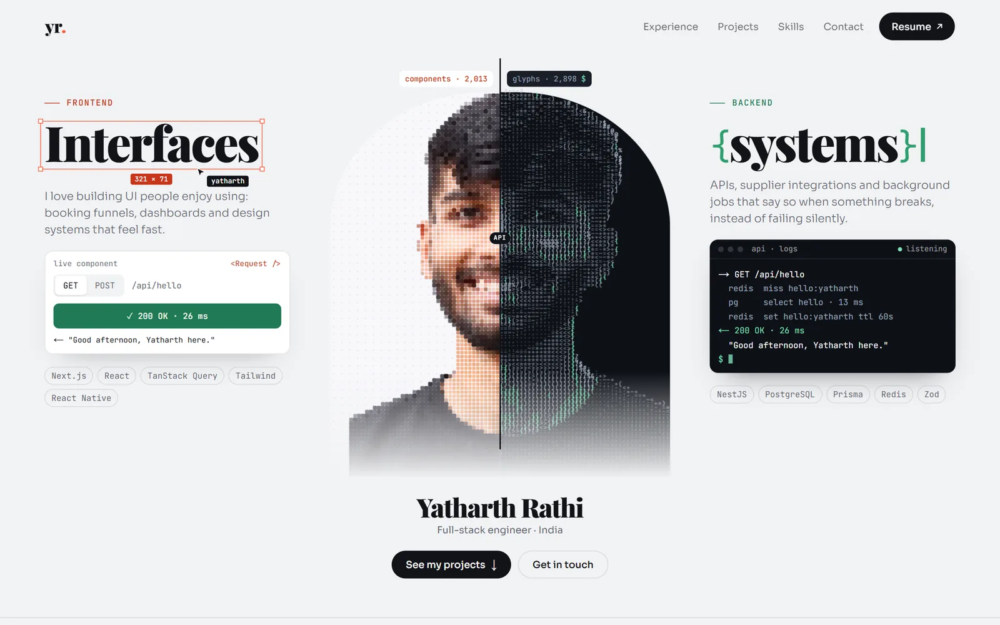
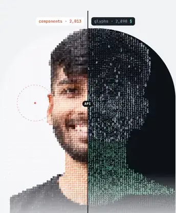
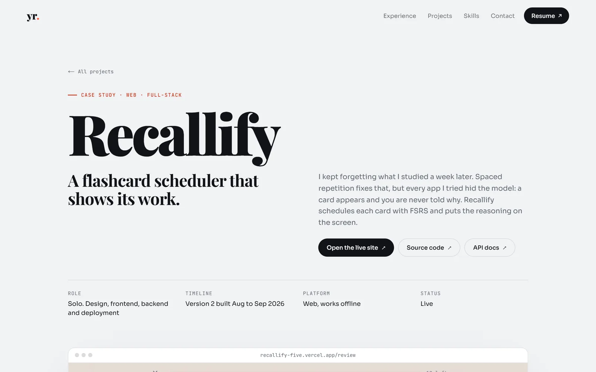
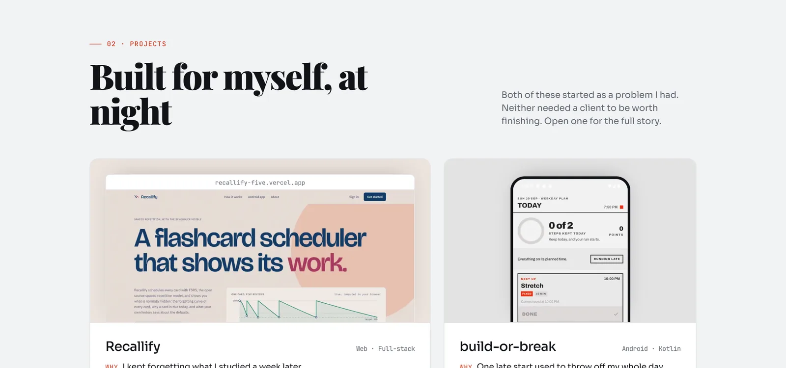
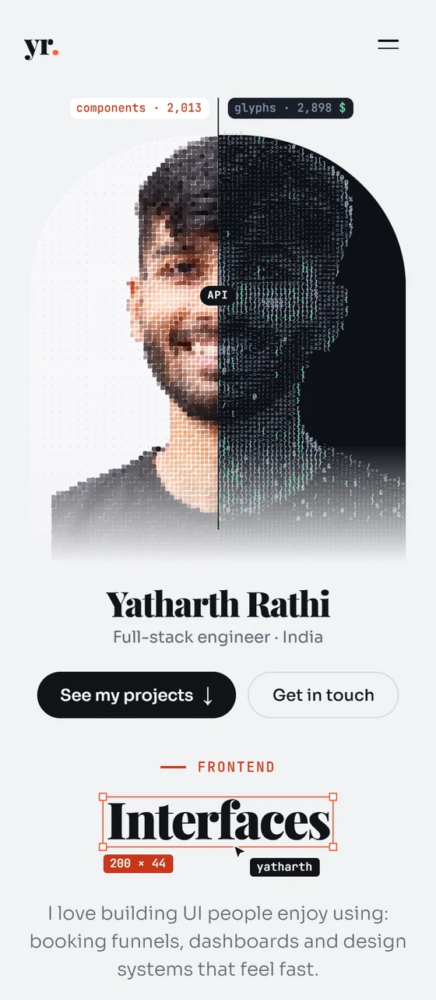

<h1 align="center">Yatharth Rathi</h1>

<p align="center">
  Full-stack engineer in Gurugram, India. This is the code behind my portfolio.
  <br />
  <a href="https://yatharthrathi.vercel.app"><strong>yatharthrathi.vercel.app</strong></a>
  &nbsp;·&nbsp;
  <a href="https://yatharthrathi.vercel.app/Yatharth-Rathi-Resume.pdf">Resume (PDF)</a>
  &nbsp;·&nbsp;
  <a href="https://www.linkedin.com/in/yatharthrathii">LinkedIn</a>
</p>

<p align="center">
  
</p>

## Why I rebuilt it

The first version of this site was a small Next.js 15 project in JavaScript, and it introduced me as a frontend developer. That stopped being true somewhere around my first supplier integration at work. These days I spend as much time on NestJS APIs, booking holds and background jobs as I do on the screens in front of them.

So I wanted the first screen to say that before anyone reads a word. The portrait is split down the middle: interface on the left, system on the right, and a thin API line between them. Everything else on the site follows from that idea. The old version is still in the git history, before `bba5d42`.

## The portrait



The photo is sampled into about 5,000 particles and drawn by hand on a 2D canvas. There is no particle library.

The left half is colour tiles. On the right, each particle becomes a character picked by brightness from this ramp:

```
.,:;-~=+*<>(){}[]/?%&$#@
```

Move the cursor across the middle and the tiles get pushed into the backend half, where they turn into code. Click and the whole thing scatters and rebuilds itself.

When nobody is touching it, the loop drops to a lower frame rate, so an open tab does not keep a laptop fan busy. With reduced motion switched on in the system settings, the portrait stays still.

<br clear="right" />

## The request that crosses it

The card on the left is a real React component, and the panel on the right is a terminal log. Press **Send request** and a packet of pixels crosses the API line. The terminal handles it the way a cached read would (a cache miss, a database query, then the cache is filled) and answers with a hello timed to your own clock.

It is simulated in the browser; there is no server behind it. But the steps are the ones the APIs I build at work actually go through, and that felt more honest than another "Hi, I'm a developer" banner.

## What else is on it

<table>
  <tr>
    <td width="62%" valign="top">
      
      <p><strong>A case study for every project.</strong> The problem, the decisions I would defend, how it is tested, and what it does not do yet. I would rather show the gaps than have someone find them.</p>
      
      <p><strong>Projects I built for myself.</strong> Both started as a problem I had, not a brief.</p>
    </td>
    <td width="38%" valign="top">
      
      <p><strong>On a phone</strong>, the portrait comes first and the two halves stack under it.</p>
    </td>
  </tr>
</table>

My work history is on the site too. Client projects are described by what they are, never by name, because that work belongs to the people who paid for it.

## How it is built

| | |
|---|---|
| **Framework** | Next.js 16 (App Router, fully static) and React 19 |
| **Language** | TypeScript 7 for `tsc`, with the TypeScript 6 API alongside it for ESLint ([the side-by-side setup](https://devblogs.microsoft.com/typescript/announcing-typescript-7-0/)) |
| **Styling** | Tailwind CSS 4, with the design tokens in `src/app/globals.css` |
| **Motion** | A hand-written canvas for the portrait, CSS scroll-driven animations for reveals (content still shows without JavaScript), Lenis for smooth scrolling |
| **Type** | Playfair Display, Sora and JetBrains Mono through `next/font` |
| **Sharing** | An Open Graph image for the site and one for each case study, drawn with `next/og` |
| **Checks** | GitHub Actions runs lint, typecheck and a production build on every pull request |

There is no backend and no environment file. All the content lives in two TypeScript files, so changing a sentence never means touching a component.

## Numbers I checked

Lighthouse on the live site, 24 November 2026:

| | Performance | Accessibility | Best practices | SEO |
|---|:-:|:-:|:-:|:-:|
| Desktop | 98 | 100 | 100 | 100 |
| Mobile | 83 to 88 | 100 | 100 | 100 |

Mobile performance is the one I gave up on purpose. A phone's CPU has to move 5,000 particles while the page loads, and I preferred the bigger portrait over the last few points. The layout is checked from 320 px phones up to wide desktop screens.

## Running it

```bash
npm install
npm run dev         # http://localhost:3000
npm run build       # production build
npm run lint
npm run typecheck
```

## Where things live

Notes for me, so a small change stays small.

- **Home page copy** (hero, jobs, education, skills): `src/content/site.ts`
- **Projects**, both the home page card and the case study: `src/content/projects.ts`. Every figure there comes from the project's own repository, so change it there first.
- **Screenshots** for the projects: `public/images/projects/`
- **The portrait**: `public/images/yatharth.webp`, a cut-out on a transparent background at 4:5. Replace it and the particles are regenerated in the browser from the new photo.
- **Images in this README**: `docs/readme/`, taken from the live site.
- **Analytics**: Vercel Web Analytics, which is cookieless. It only loads on Vercel and has to be switched on in the project there.

### Updating the resume

The resume is written in `resume/resume.html`. Edit that file, never the PDF, then print it again with an installed Chrome or Edge:

```bash
npm run resume                      # public/Yatharth-Rathi-Resume.pdf, the one the site links to
npm run resume -- "+91 XXXXX XXXXX" # also resume/private/Yatharth-Rathi-Resume.pdf, with a phone number
```

The copy with the phone number is for job applications. `resume/private/` is ignored by git, so the number never reaches GitHub. The Resume button on the site appears once the PDF exists; in `npm run dev` it always shows.

## Say hello

If something here is useful to you, or you would like to talk about how any of it works, I am at [yatharthmaheshwari01@gmail.com](mailto:yatharthmaheshwari01@gmail.com). I am also on [LinkedIn](https://www.linkedin.com/in/yatharthrathii) and [GitHub](https://github.com/yatharthrathii).
